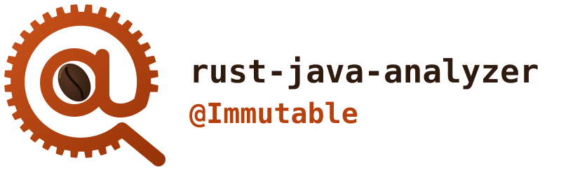

# The rust-java-analyzer logo

<!-- markdownlint-disable-next-line MD033 -->
 

This file explains what the logo means and gives everything needed to redraw it from scratch.

## Files

| File | Contents |
| --- | --- |
| [`logo.svg`](logo.svg) | The mark on its own. This is the master: every other file is made from it. |
| [`logo-wordmark.svg`](logo-wordmark.svg) | The mark with the project name and `@Immutable` beside it. |
| [`logo-512.png`](logo-512.png) | The mark, 512 × 512, transparent background. |
| [`logo-32.png`](logo-32.png) | The mark, 32 × 32, transparent background, for icons. |
| [`logo-wordmark.png`](logo-wordmark.png) | The wordmark, 1600 × 512, transparent background. |
| [`social-preview.svg`](social-preview.svg) | The GitHub social preview banner. |
| [`social-preview.png`](social-preview.png) | The banner, 1280 × 640, for uploading to GitHub. |

## What it means

The logo is an `@` sign, because the project checks a Java annotation, `@Immutable`. Each part of the `@` stands for part of the project:

| Part | Stands for |
| --- | --- |
| Gear teeth around the outer ring, in a rust-orange color | Rust, the language the analyzer is written in. |
| The outer ring's tail, which turns into a magnifying-glass handle | The analyzer, which inspects code. |
| A coffee bean inside the bowl of the inner "a" | Java, the language being analyzed. |

The logo deliberately uses none of the official logos: not the Rust gear-with-an-R, not Ferris the crab, and not the Java steaming cup. Those are trademarks. A generic gear, a rust color, a coffee bean, and an `@` carry the same meaning without borrowing anyone's brand.

An earlier version had a keyhole in place of the bean's crease, to stand for immutability. It was dropped; the wordmark's `@Immutable` line carries that meaning instead.

## Construction

The mark is drawn on a 256 × 256 canvas, with the origin at the top left and y increasing downward. All the shapes except the bean are filled or stroked with the rust gradient. Angles are in degrees, measured clockwise from the positive x axis, as SVG measures them.

There are two centers, which are deliberately different, so that the inner "a" sits slightly left of and below the center of the outer ring:

- The outer ring and the gear are centered at (116, 116).
- The bowl of the inner "a" and the bean are centered at (106, 118).

The parts are drawn in this order, so that later ones cover earlier ones.

### 1. Gear teeth

There are 32 tooth positions, evenly spaced around (116, 116), centered at angles `5.625 + 11.25 × i` for i = 0 to 31. Leave out the positions whose angle is between 12° and 58°. That is the gap on the right of the ring where the stem joins it and the handle leaves it, so 28 teeth remain.

Each tooth is a trapezoid with four corners:

| Corner | Radius | Angle |
| --- | --- | --- |
| Base, first side | 97 | center − 3° |
| Tip, first side | 109 | center − 2° |
| Tip, second side | 109 | center + 2° |
| Base, second side | 97 | center + 3° |

The base, at radius 97, is hidden under the ring, which reaches out to radius 100. So each tooth shows as 9 units tall. The teeth are filled and also stroked 2 wide with round joins, which softens their corners.

This Python computes the path data in `logo.svg`:

```python
import math
cx = cy = 116
parts = []
for i in range(32):
    a = 5.625 + 11.25 * i
    if 12 <= a <= 58:
        continue
    corners = [(97, a - 3), (109, a - 2), (109, a + 2), (97, a + 3)]
    xy = [(cx + r * math.cos(math.radians(d)), cy + r * math.sin(math.radians(d)))
          for r, d in corners]
    parts.append("M" + " L".join(f"{x:.1f} {y:.1f}" for x, y in xy) + "Z")
print(" ".join(parts))
```

### 2. The bowl of the inner "a"

A circle centered at (106, 118), radius 40, no fill, stroke width 18.

### 3. The stem, the outer ring, and the handle

One open path, stroke width 20, round caps and round joins, no fill:

```text
M 146 80                  top of the stem, on the right side of the bowl
L 146 134                 straight down the stem
C 146 160 178 166 200 147 the stem's foot curls out to the ring at 20°
A 90 90 0 1 0 174 185     the outer ring: radius 90, the long way round,
                          counterclockwise, to 50°
L 226 228                 the magnifying-glass handle
```

The ring's centerline is at radius 90, so with stroke width 20 it covers radii 80 to 100. It leaves a gap on the right, between 20° and 50°. The stem's foot comes into the gap from above, and the handle leaves from below. The handle meets the ring at a rounded corner, not a smooth curve.

### 4. The coffee bean

The bean is drawn around its own origin and then placed with `translate(106 118) rotate(-30) scale(0.85)`. That puts it in the center of the bowl, tilted 30° counterclockwise from vertical. Before the transform, it has three parts:

- **Body:** an ellipse at (0, 0), radius 25 across and 34 tall, filled with the roast gradient.
- **Crease:** an S-shaped line, `M 1 -29 C -11 -12 11 12 -1 29`, in `#1A0D06`, stroke width 4.5, round caps.
- **Highlight:** a short curve on the upper left, `M -17 -20 Q -10 -30 2 -32`, in `#8A5A3C`, stroke width 3.5, round caps, opacity 0.8.

### Colors

| Name | Use | Definition |
| --- | --- | --- |
| Rust | Gear, bowl, stem, ring, handle | A linear gradient from `#C9521A` at (16, 16) to `#963208` at (236, 236), in canvas coordinates (`gradientUnits="userSpaceOnUse"`). It is in canvas coordinates so that all the rust parts share one gradient and look like one piece of metal. |
| Roast | Bean body | A radial gradient on the ellipse's bounding box: center (0.4, 0.3), radius 0.8, from `#5A3824` to `#2E1A0F`. The lighter spot is at the upper left. |
| Crease | Bean crease | `#1A0D06` |
| Highlight | Bean highlight | `#8A5A3C` at opacity 0.8 |
| Text | Wordmark project name | `#2E1A0F`, the dark end of the roast gradient |
| Accent | Wordmark `@Immutable` | `#B7410E`, a flat rust |

The background is transparent everywhere. The logo is meant for light backgrounds. On a dark background the bean has too little contrast, and would need a light outline.

### The wordmark

The wordmark canvas is 800 × 256. The mark is copied unchanged into its left 256 × 256. The text is bold and monospaced: `'JetBrains Mono', 'SF Mono', Menlo, Consolas, monospace`. It is in two lines, both starting at x = 270:

- `rust-java-analyzer`: baseline y = 118, size 46, Text color.
- `@Immutable`: baseline y = 176, size 40, Accent color.

The SVG uses whichever of those fonts the viewer has, so its text can look slightly different from one machine to another. The PNG is fixed in the font it was rendered with.

### The social preview banner

GitHub shows the social preview image when a link to the repository is shared. GitHub recommends 1280 × 640, so the banner canvas is that size. Unlike the other files, the banner has a solid background, `#FBF6EF` (a pale cream), because sites that show the preview may put it on any color.

- **Mark:** copied unchanged from `logo.svg` and placed with `translate(135 141) scale(1.4)`, so it is 358 × 358 and vertically centered.
- **Text:** three lines, all starting at x = 565:
  - `rust-java-analyzer`: baseline y = 290, size 58, bold monospace (the wordmark font list), Text color.
  - `@Immutable`: baseline y = 362, size 48, bold monospace, Accent color.
  - `A static analyzer for Java source code, written in Rust.`: baseline y = 440, size 26, regular sans-serif (`-apple-system, 'Segoe UI', Helvetica, Arial, sans-serif`), `#5A3824`.

To use it, go to the repository's **Settings** page, find **Social preview** under **General**, and upload `social-preview.png`. GitHub does not take SVG there.

## Making the PNGs

The PNGs are rendered from the SVGs with `rsvg-convert` (from librsvg; `brew install librsvg`). From this folder:

```sh
rsvg-convert -w 512  logo.svg          -o logo-512.png
rsvg-convert -w 32   logo.svg          -o logo-32.png
rsvg-convert -w 1600 logo-wordmark.svg -o logo-wordmark.png
rsvg-convert -w 1280 social-preview.svg -o social-preview.png
```

At 32 × 32 the gear teeth and the `@` are still clear. The bean shows as a dark dot.
